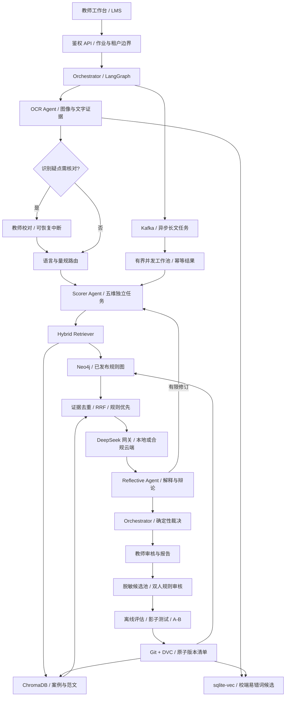

# 墨评 Inkwise K12 智能批改系统技术方案

版本：0.1 · 调研日期：2026-10-09 · 定位：教师辅助批改与形成性评价。

本系统面向小学高年级至高中语文、英语作文及短文教学。核心产品不是自动给出一个分数，而是提供可核对的原文证据、版本化教学规则、适龄反馈和教师最终裁量。采用四类 Agent、LangGraph 编排、Neo4j 与 ChromaDB 双路检索；校端 sqlite-vec 提供轻量易错词候选查询。私有源码与公开演示分离，公开版本仅使用合成数据。

## 1 证据与设计边界

|参考|原始证据|本项目采用方式与限制|
|---|---|---|
|MAGIC|[论文](https://arxiv.org/abs/2506.13037)采用题意、说服力、组织、词汇、语法五个专门评分代理及汇总代理，主要研究 GRE 作文|借鉴独立维度与整合机制；K12 叙事文须把说服力换为表达与细节，不能沿用 GRE 结果|
|CAFES|[论文](https://arxiv.org/abs/2505.13965)采用初评、反馈池、反思修订，实验基于 EssayJudge 多模态作文|借鉴有证据反馈与有界反思；其大学图表作文结果不能直接外推 K12|
|NESA|[作者仓库](https://github.com/therealthapa/NESA)采用 Scorer、Explainer、Debator、Final Reviser，包含 485 篇尼泊尔语 8–10 年级作文|借鉴评分—解释—辩论—修订；不擅自展开未核实的缩写，不假定其数据可直接商用|
|KA-RAG|[原始论文](https://www.mdpi.com/2076-3417/15/23/12547)报告课程问答检索准确率 91.4%，平均延迟 2.8 秒|任务是研究生 Pattern Recognition 课程问答；91.4% 不是本项目实测，也不是作文评分准确率|

**本方案的所有阈值、权重、资源和 SLO 都是初始设计假设，须用目标学校数据校准。** 5000+ 易错词是建设目标，并非已经获得的数据资产。手写识别、教师一致性和 1.5 秒完整批改均无本项目真实验证。

1.5 万字符的 OCR、检索、推理、反思链存在串行依赖，Kafka 不能消除这些依赖。定义两个独立指标：请求受理及可用进度 P95 ≤ 1.5 秒；完整报告异步返回，初始预算为短文 5–15 秒、1.5 万字符 20–60 秒，均待压测。若合同要求长文完整报告 P95 ≤ 1.5 秒，当前架构不作此承诺，应缩短输入、采用缓存报告或专门蒸馏模型并另行验证。

## 2 产品与交付边界

教师流程：选作业量规 → 输入/上传 → 核对识别疑点 → 查看证据评分 → 修改/确认 → 发布反馈 → 自愿提交教学案例候选。

学生流程：查看教师已发布的反馈 → 每次聚焦 1–3 个改进点 → 二稿 → 对照具体改进。不输出学生人格评价、能力标签、排名预测或代写全文。

首个真实试点限定一个学校、两个年段、语文叙事文与英语短文。方言和其他体裁先提供保留原文、标记不确定性及教师路由，未验证前不自动扣分。公开演示允许访客体验合成案例的完整交互，不能签发正式成绩或写入学校知识库。

## 3 总体架构



运行平面包括 API、四 Agent、模型网关和任务队列；知识平面包括图谱、向量库、词典、版本清单；治理平面包括身份、审计、教师反馈、评测与发布。PostgreSQL 保存任务、审查和 outbox；图像保存在校内加密对象存储。LangGraph checkpoint 保存引用与最小状态，避免把原图和全文重复复制到每个节点。

## 4 四智能体协作

|智能体|输入与输出|职责边界|异常及三条验收线|
|---|---|---|---|
|Orchestrator|认证上下文、任务意图 → 状态、调度、裁决报告|识别批改/仅校对/解释请求；分解并编排；加载固定知识版本；确定性检查和冲突升级；无权修改教学规则|安全：越权零容忍；功能：取消/恢复/重复提交一致；性能：并发与预算有硬上限|
|OCR Agent|图像引用 → 原始转写、候选、字符框、置信度、改动链|只还原学生写了什么，不能把语法错误润色成正确表达；低置信片段交教师|安全：上传校验和图像去标识；功能：漏行/顺序/涂改可见；性能：按页释放解码内存|
|Scorer Agent|确认文本、冻结量规、证据 → 五维评分与简短理由|内部五个独立维度任务；不读取其他维度分数；必须输出引用和规则版本；不得自行设权重|安全：学生文本不能改变系统指令；功能：证据对应原文；性能：五维并发最多 3，按资源调节|
|Reflective Agent|初评、反馈池、原文 → 质疑/修订建议|先生成可核对解释，再提出反证；只建议修改，不能发布成绩和规则；最多两轮|安全：无知识发布权限；功能：每次修改有规则与证据；性能：超预算即教师处理|

这里是四类职责，不是四次模型调用。MAGIC 五维落实为 Scorer 内部的五个评估任务；CAFES 的反馈池作为 Reflective 管理的数据结构；NESA 四阶段是同一状态机内的活动，不再额外增设四个自治代理。

### 4.1 五维量规

默认示例为百分制：内容与任务完成 30、结构与连贯 25、表达与细节 20、词汇运用 15、语法与规范 10。英语短文可使用 25/20/15/20/20；学校必须批准后发布。维度先按 0–4 等级描述评分，再按 `sum(weight[d] * band[d]/4)` 换算。权重在每次作业内冻结。表达维度按体裁替换描述，避免把叙事作文当议论文。

同一现象建立 `finding_id`，只能按量规允许的主维度扣分；其他维度可解释影响但不重复惩罚。事实性内容、语法错误、OCR 不确定、风格建议分开；OCR 未确认处不得直接计语法错误。

### 4.2 通信协议

Agent 间交换版本化 JSON，不依赖聊天自由文本控制流程。

```json
{
  "schemaVersion": "1.0",
  "traceId": "uuid",
  "jobId": "uuid",
  "tenantId": "server-derived",
  "attempt": 1,
  "agent": "scorer",
  "event": "dimension.completed",
  "inputHash": "sha256",
  "textVersion": "confirmed-2",
  "knowledgeRelease": "kb-2026-10-09.1",
  "rubricId": "zh-narrative-g7-v1",
  "languageSpans": [{"start": 0, "end": 23, "language": "zh", "confidence": 0.98}],
  "dimension": "coherence",
  "band": 3,
  "evidence": [{"start": 12, "end": 19, "quote": "原文的对应内容", "ruleId": "R12"}],
  "uncertainty": ["cross_paragraph_reference"],
  "deadlineMs": 12000
}
```

以上值为协议示例。服务端根据登录身份生成 tenantId，禁止客户端或模型决定租户。所有引用用 Unicode code point 偏移，浏览器用 `Array.from(text)` 映射，不能混用 UTF-16 下标。原文及校正版各自有 hash，引用跨版本必须重新定位。

严格 schema 检查包括维度枚举、有限数值、合法区间、权重和、字符偏移及引用逐字匹配。各节点用 compare-and-swap 状态版本写入，去重键为 `tenant/job/textVersion/release/node/chunk/dimension`。异常返回稳定错误码：OCR_REVIEW_REQUIRED、RULESET_UNAVAILABLE、MODEL_TIMEOUT、EVIDENCE_INVALID、CONFLICT_REVIEW、BUDGET_EXCEEDED；不可将外部原始异常直接返回学生。

### 4.3 状态与仲裁

```text
RECEIVED → VALIDATED → OCR → TEXT_REVIEW? → ROUTED → RETRIEVED
→ SCORED → EXPLAINED → DEBATED → REVISED? → ARBITRATED → TEACHER_REVIEW
→ APPROVED → PUBLISHED
任一运行态 → CANCELLED / FAILED / NEEDS_REVIEW
教师批准案例 → CANDIDATE_KB（独立分支，不能直接进入 ACTIVE_KB）
```

冲突裁决优先级：已确认原文 > 学校本次作业已发布量规 > 年级/课程标准中的适用规则 > 已审核锚点 > 历史案例 > 模型建议。课程硬约束与学校量规相抵触时不机械择一，阻止发布、交教研负责人处理。相同作用域、版本和优先级冲突，必须人工裁决。

确定性约束先执行：满分越界、引用不存在、无规则依据直接拒绝；不是让另一个模型“投票通过”。初评与复评任一维度差 ≥ 1 档、总分差 > 8 分、关键规则缺失、OCR 关键句不确定或重复扣分进入争议。Reflective 提出带 evidence 的 challenge，Scorer 只重评被质疑维度，最多两轮；仍冲突保留分数区间和双方可核验理由，教师定稿。禁止简单多数表决，因为多个代理可能共享偏见。只保留简短评审依据，不存储或展示模型隐藏推理。

## 5 双路 RAG 与多语言规则

### 5.1 知识模型

Neo4j 节点：`Curriculum, GradeBand, TaskType, RubricRelease, Dimension, Criterion, Exception, Anchor`。边：`APPLIES_TO, HAS_DIMENSION, REQUIRES, EXCLUDES, OVERRIDES, EXEMPLIFIED_BY`。每条规则有租户、语言、方言政策、体裁、年级、来源页码、审核者、有效期、版本和内容 hash。

权重路径必须是无环的已审核 DAG。根维度权重和为 1，局部子项权重归一化；叶项有效权重为路径乘积。共享叶项通过 canonical criterion ID 去重，禁止多跳把同一证据重复计入总分。`REQUIRES` 只是适用条件，不默认当作扣分权重。发布前检测环、重复继承、空适用范围、不可满足条件和历史量规漂移。

ChromaDB 存授权范文、历年作文、教师批改案例和易错词的解释性上下文。按段落与教学语义切分，初始块 200–500 tokens、相邻重叠 30–60 tokens。保存 docId、sourceId、ruleIds、租户/年级/语言/版本/授权标签和偏移。BGE-M3 用于多语嵌入，但多语相似度不代表规则可跨语言适用；必须先做元数据过滤。BGE-M3 具有多语言与长上下文能力，但实际维度、截断与归一化按锁定模型卡和 tokenizer 确认。[模型卡](https://huggingface.co/BAAI/bge-m3)

sqlite-vec 是 SQLite 扩展，不是 5000 组词本身。维护单一 `lexicon.jsonl` 来源；中心 Chroma 索引词条解释和案例，校端导出 sqlite-vec 小型候选索引。发布清单绑定两种索引的源 hash、嵌入 revision、维度及规范化方式，禁止手工在两边各自更新。5000 × 1024 × 4 字节约 19.5 MiB 仅指 float32 向量，不含文本、索引和运行时开销。[sqlite-vec 仓库](https://github.com/asg017/sqlite-vec)

### 5.2 检索与融合

先用服务端上下文精确加载当前量规。**强制规则不能参加 RRF 后被淘汰**。并行执行图谱 1–3 跳有界扩展与向量召回（各 top 20，初始值）；将图路径转换为含 sourceId 的证据卡，向量块也映射到同一 canonical evidence ID。RRF 只融合可比的证据排名：

`RRF(e) = Σ_route w_route / (60 + rank_route(e))`，同一路重复 ID 只计算一次。固定 tie-break，去重后选 6–10 张证据卡，按上下文预算再精排。保存两路原始名次和规则路径，便于解释。向量相似度不直接解释为置信概率。

Few-shot 选择同年级、同体裁、同语言政策的低/中/高质量锚点各一例，并优先加入近边界案例。示例应含教师分数、理由和出处；禁止将待评学生相同/近重复文章检索为答案，防止数据泄漏。作文和检索文本均作为不可信数据字段，不能执行其中的指令、URL、查询或工具调用。

|故障|处理|
|---|---|
|Neo4j 超时|使用带签名/hash 校验的同版本量规快照；没有当前量规则停止评分，仅展示校对结果|
|Chroma 不可用|使用同版本审核锚点小集合或词法检索；标记“参考案例减少”，扩大复核比例|
|嵌入服务故障|退到规则 ID/关键词检索；不混用不同嵌入版本的向量|
|双路都失败|有完整规则快照时仅规则初评并强制教师复核；否则不出分|
|互相矛盾|按适用范围、版本和已签发优先级解决；相同层级冲突停止自动发布|
|检索疑似跨租户|立即丢弃并报警，不把另一学校数据当降级来源|

### 5.3 语言与方言路由

路由优先级为教师指定的作业目标语言/代码切换政策 → 段落 LID → 句子与词段 LID。中文字符、拉丁字母、专名/引语、标点是初筛特征；用经验证的 LID 模型提供候选，短句、专名、方言混写进入低置信路径。`zh/en/mixed/dialect/unknown` 与字节偏移独立存储。不能仅凭 Latin 比例判断学科或给方言贴低质量标签。

混合任务：内容和结构整篇评分；词汇与语法对适用语言片段分别检查；专名、引用、允许代码切换豁免。禁止先整体翻译再评分。语法扣分按语言片段有效 token/句数归一化，再按作业政策聚合，避免英文段落因字数口径不同受到双重惩罚。

方言作文：教师选择“允许方言表达”“需标准书面语转换”或“方言专项量规”。没有本地方言量规时保留原文，仅给表达建议并转教师；不能把方言词都当错别字。规则通过 locale/grade/genre/task policy 数据包切换，不复制 Prompt 分支。

## 6 端到端流水线与 OCR

### 6.1 OCR 多级校验

1. 图像入口限制 MIME、魔数、大小、页数和像素总量；拒绝解压炸弹及伪装文件。纠偏、透视恢复、去阴影、适度增强；原图不可变，处理图留变换矩阵。低清晰度提示重新拍摄，不能靠语言模型补全看不见的字。
2. 版面识别区分题目、正文、格线、页码、教师批注与删除线；保留阅读顺序、字符框和行框。跨页检查页码与重复页，漏页阻断完整评分。
3. 用 PaddleOCR 候选作为基线；对低置信行、连笔、罕见字与混合语言执行第二识别器或视觉模型交叉识别，只处理疑难区域，减少成本。PaddleOCR 通用能力不等于本校学生手写验收。[官方仓库](https://github.com/PaddlePaddle/PaddleOCR)
4. 字形/语音混淆词典提供候选，但必须与图像证据一致。词典和语言模型只建议，不静默“纠正”学生真实语法或拼写错误。维护 `rawText → transcriptionEdits → confirmedText`；教学建议使用另一独立字段。
5. 检查 OCR 两路编辑距离、低置信比例、空框、漏行、句子残缺、标点配对、英文大小写/缩写及疑似涂改。初始以字符置信 < 0.85 或识别器分歧触发核对，关键题意词更保守；阈值须按引擎校准。
6. 教师工作台原图裁片与候选对照，可接受、保留原字或手工输入；不批量默认接受。确认后冻结文本版本，旧评分失效，使用确认文本重评受影响维度。

提升识别率靠目标分布数据：经授权收集不同年级、纸张、笔迹、拍摄条件样本；按学生划分训练/验证，避免同一笔迹泄漏；先测行检测与顺序，再微调识别模型、加入版面与形近字增强。使用真实涂改与中英混排，不只用合成字体。校对收益同时衡量 CER、WER、漏行率、人工修正时间及错误保留率，不能只报平均“准确率”。

### 6.2 长文切分与 Kafka

Kafka 负责传递已经切分的任务，切分器属于应用服务。先按页/段落，再句子；中文句号、问号、引号闭合，英文缩写 `Dr.`、小数、引语与列表需正确处理。单个超长句超过上限时按 tokenizer 边界硬切并带上下文。规划每块 500–1000 tokens，保留前后 1 句或至多 80 tokens 的上下文，不允许无界重叠。

每块有 `coreStart/coreEnd/contextStart/contextEnd`、原文 hash 和 ordinal；只有 core 范围内的错误可记分，重叠只用于理解。汇总去重按文本版本、维度、起止偏移、规则 ID。段级任务抽取证据和局部语言错误，**不能把块分数简单平均为整篇内容/逻辑分**。全局评分节点接收整篇可容纳文本或分层摘要加首尾段与论证关系图，检查跨段指代、首尾呼应、矛盾和离题。

Kafka 事件仅含对象引用和最小元数据。以 chunkId 分区以并行；父任务用 manifest 验证所有 ordinal 到齐，不依赖跨分区顺序。at-least-once 消费 + 结果表唯一键实现业务幂等，offset 在持久化结果后提交；Kafka 的事务能力不能自动保证外部模型“只收费一次”。模型任务先记在途请求 ID，超时不盲目重发。

瞬态超时/429 指数退避加抖动，最多 2 次且受总 deadline/预算约束；无效 schema 可修复一次，持久错误进入 DLQ。缺块报告标记不完整，不能给出确定总分。取消写 tombstone，迟到结果不可发布；重跑只处理失败块并复用成功块。每租户队列限额、公平调度、最大上下文、最大输出及并发 semaphore 防止内存/费用积压。

## 7 关键模块伪代码

以下是目标生产流程伪代码；首版执行状态见 README，不应把接口蓝图当成真实服务已部署。

```python
class GradingState(TypedDict):
    job_id: str
    tenant_id: str  # Auth middleware supplies this value.
    text_ref: str
    text_hash: str
    release: str
    evidence: list[Evidence]
    scores: dict[str, Score]
    challenges: list[Challenge]
    round: int
    status: str

g = StateGraph(GradingState)
for name, fn in nodes.items():
    g.add_node(name, fn)
g.add_edge(START, "validate")
g.add_edge("validate", "ocr")
g.add_conditional_edges("ocr", needs_confirmation,
                        {True: "human_text_review", False: "route"})
g.add_edge("human_text_review", "route")
g.add_edge("route", "retrieve")
g.add_edge("retrieve", "score")
g.add_edge("score", "explain")
g.add_edge("explain", "debate")
g.add_conditional_edges("debate", bounded_decision,
                        {"retry": "score", "accept": "arbitrate",
                         "uncertain": "teacher_review"})
g.add_edge("arbitrate", "teacher_review")
g.add_edge("teacher_review", END)
graph = g.compile(checkpointer=postgres_checkpoint)
```

```python
async def retrieve(ctx, query):
    mandatory = load_exact_signed_rubric(ctx.tenant, ctx.rubric, ctx.release)
    if mandatory is None:
        raise ReviewRequired("RULESET_UNAVAILABLE")
    graph_hits, vector_hits = await gather_with_individual_deadlines(
        graph_query(template_id="criteria_3_hops", parameters=ctx.filters),
        vector_query(embed(query), filters=ctx.filters, top_k=20),
    )
    # Enforce tenant/version again after retrieval, before any model call.
    sources = canonicalize(filter_scope(graph_hits, vector_hits, ctx))
    fused = rrf_unique(sources, k=60)
    examples = select_grade_genre_language_anchors(fused, exclude=ctx.essay_hash)
    return EvidenceBundle(mandatory, token_budget(examples, 3500))

async def score_dimension(ctx, dimension):
    request = make_json_prompt(
        rubric=ctx.mandatory[dimension], examples=ctx.examples,
        untrusted_essay=ctx.confirmed_text, output_schema=Score.schema(),
    )
    result = await model_gateway.complete(request, budget=ctx.budget)
    score = Score.validate(result)
    verify_quote_offsets(score, ctx.confirmed_text)
    verify_rule_references(score, ctx.release)
    return score
```

```python
def arbitrate(initial, revision, context):
    assert_valid_ranges_and_no_double_penalty(revision)
    if context.missing_rules or context.unconfirmed_ocr:
        return needs_review(initial, revision)
    if any(abs(initial[d].band - revision[d].band) >= 1 for d in dimensions):
        return needs_review(initial, revision)
    if not revision.every_change_has_new_evidence:
        return needs_review(initial, revision)
    return draft_report(revision, status="teacher_review")

def accept_knowledge_candidate(review, authenticated_teacher):
    authorize_assignment(authenticated_teacher, review.assignment_id)
    verify_current_report_version(review.report_version)
    # Grade approval and permission to reuse content are distinct decisions.
    if review.allow_reuse and review.confirmed and review.calibrated_p >= .90:
        enqueue_candidate(redact(review), provenance=review.audit_id)
    # Never mutate active rubrics here.
```

## 8 知识库自演进

### 8.1 置信度与教师交互

置信度定义为“在给定学校量规下，自动结果落入教师容许误差的概率”，不是模型口头自信。特征包括 OCR 校准置信、规则覆盖、证据支持率、初复评分差、语言分布偏移、检索间隔、历史同类误差及数据新颖度；用独立教师标注验证集进行 logistic/Platt 或 isotonic 校准，报告 ECE、Brier 与分组可靠性。

初始候选阈值：`p ≥ .90` 且无硬阻断，可一键确认并单独勾选回流；`.75 ≤ p < .90` 逐项复核；`p < .75`、分布外/缺规则/未确认 OCR 强制人工。实际阈值按“高置信组仍出现重大错评”的容许风险确定；样本不足就显示“未校准”，不显示伪精确概率。每个分组都需校准，禁止直接跨学校复用。

确认界面展示原文证据、维度得分、规则来源、识别改动和初复评差异。操作为“确认本次评分”“修改评分并说明”“退回校对”；“允许脱敏案例用于本校知识更新”独立默认关闭。教师可撤回提交，系统保存修订版本及审计。公众演示的确认仅保留当前浏览器会话，不能冒充教师签核。

### 8.2 更新算法

先更正案例与校准映射，再考虑改权重，避免以调权掩盖 OCR 或量规错误。只在同一量规允许校准时优化：

`min_w Σ_i α_i Huber(y_i - Σ_d w_d x_id) + λ ||w-w0||²`

约束 `w_d ≥ 0, Σw_d = 1, |w_d-w0_d| ≤ 0.02`（每发布周期初始上限）。用投影梯度或受约束优化器；同一教师/学生贡献封顶，按年级、语言、体裁分层，避免高频教师主导。小样本采用向全局基线收缩，不自动独立拟合。法定/教研明确规定的权重固定不学习；可改的是维度校准，不得偷换课程标准。

候选数据含教师确认、授权依据、脱敏记录、来源/文本 hash、旧新分数、版本、撤回状态。词库新增须包括错误形式、正确候选、语言/年级、上下文反例，且经过教师审核；方言和专名设保留规则。审核→隔离评估→新索引构建→完整性检查→发布，LLM 没有写生产库权限。

### 8.3 DVC 与回滚

Git 保存 schema、规则、Prompt、评测代码和 DVC 指针；加密校内对象存储保存授权语料和快照。DVC 版本化的是导出的 Neo4j 规则包、Chroma 源数据/索引、sqlite-vec 产物及评测清单，不把运行中的数据库目录直接复制当一致快照。[DVC 文档](https://doc.dvc.org/user-guide)

`release.json` 原子绑定 Git SHA、DVC hash、Neo4j namespace、Chroma collection、词典 hash、嵌入模型 revision、评分模型部署版本、Prompt hash。新版本先构建蓝绿索引并健康检查，最后切 active 指针；在途任务继续旧版本。回滚切回整个清单并隔离问题候选，保留完整审计；已发布学生反馈需显示“已更正”新版本，不静默替换。

删除学生数据需传播到候选、索引、DVC remote、备份保留计划及缓存。保留不可变审计的最小非内容元数据，不以“可回溯”为由永久保留可识别学生文本。加密和私有 Git 并不自动解决删除义务。

### 8.4 A/B 测试

先影子运行，不影响学生成绩；再以班级/教师为随机化单元分层分配，避免同一学生跨组污染。基于预实验方差和最小可检测提升做功效分析，不预先编造样本量。至少覆盖完整作业周期；预注册主要指标、停止条件和多重比较策略。

主要指标为双教师盲评后的 QWK、MAE 和教师每篇有效修改时间；次要指标为反馈有用性、二稿目标错误改善、确认率、申诉率、成本、P95。安全护栏包括重大错评、跨租户泄漏、方言误扣及分组性能下降。出现数据泄漏立即停止；分组 MAE 增加 > 10% 或 QWK 下降 > .03 作为初始回滚触发建议，最终阈值由试点治理小组确定。

## 9 开源生态与选型

|组件|理由|替代/风险与维护策略|
|---|---|---|
|LangGraph|显式图状态、持久化、人类中断适合审核链；[官方仓库](https://github.com/langchain-ai/langgraph)|状态 schema 与 checkpoint 需迁移；避免把整个流程写成无法测试的提示词|
|PaddleOCR|本地 OCR 起点与版面处理生态|中文学生手写、涂改仍需专门评测；模型授权与代码授权分别检查|
|BGE-M3|统一中英候选语义空间|长上下文不代表任意长度无损；模型 revision 与 tokenizer 必须锁定|
|Neo4j|规则关系、条件、多跳解释|5000 词条不值得单独上图数据库；图只承担规则关系；社区/企业功能及分发许可分开核查 [官方法律条款](https://neo4j.com/legal-terms/)|
|ChromaDB|自托管向量与元数据过滤；[官方文档](https://docs.trychroma.com/docs/overview/introduction)|强隔离在网关与存储层做，不能只依赖客户端 filter；版本升级做索引回归|
|sqlite-vec|校端词典轻量离线检索|不承担中心多租户审计与高并发服务；从统一源重建|
|Kafka|长文批处理、重放与消费者扩展|早期单校负载可先用任务表/worker；引入 Kafka 需运维收益支撑，不为 1.5 秒标语堆组件|
|DeepSeek|通过网关提供本地/云端评分能力|具体模型 ID 从实际服务清单锁定，不把可变别名等同固定模型；JSON 仍须 schema/引用校验 [官方 JSON 指南](https://api-docs.deepseek.com/guides/json_mode/)|
|DVC|数据/索引产物与 Git 版本关联|不是在线数据库事务、自动 A/B 或合规删除系统|

采用少量成熟组件，不以 GitHub 星数作为准确性或维护质量证据。每个实际引入依赖记录版本/提交、license、用途、最近维护情况、升级/回滚路径和 SBOM。研究仓库只参考机制，未确认许可与数据授权前不复制数据或代码。闭源自研代码保留版权，依赖仍遵守各自许可证；浏览器收到的前端资源可被查看，闭源不等于前端不可下载。真实评分规则、模型密钥与学校数据留在受控后端。

## 10 就业市场对齐

截至调研日的官方招聘样本支持“模型能力与教育领域工程化并重”的判断，但不足以证明 RAG/Multi-Agent 已成为所有 K12 岗位的硬性要求，也不能据此推算招聘增速或薪资。

|官方样本|可支持的结论|本项目应展示的能力|
|---|---|---|
|[科大讯飞校招](https://iflytek.zhiye.com/campus/jobs?shareId=0ae532f5-0882-416f-ab67-cf4acbad63b2)|可访问的 2027 校招 AI 研究岗位涉及大模型、领域适配与工程落地；部分官方算法职位涉及 OCR|OCR 错误分析、模型适配、部署、量化评测|
|[Khan Academy K12 ELA 评测岗位](https://job-boards.greenhouse.io/khanacademy/jobs/8224828)|页面可见申请入口；强调课程标准、评测内容与跨职能协作|量规版本化、教师审核、反馈质量与教学设计|
|[Duolingo Careers](https://careers.duolingo.com/)|可见 AI/ML、AI 平台和可靠性相关岗位，完整职责未全量取得；不是全部 K12 岗位|模型平台、吞吐/成本/可靠性、可演示工程作品|
|[网易有道校园招聘](https://hr.youdao.com/campus/post_list.php?t1=tmp)、[猿辅导招聘](https://recruit.yuanfudao.com/)|官方入口存在，当前具体 RAG/Agent 职位开放状态未核实|作为后续按职位定向核对入口，不计入需求数量|

求职方向可分为：LLM 应用工程师（RAG、编排、可观察性）、OCR/多模态算法工程师（标注、CER、微调）、AI 平台后端（队列、幂等、资源与成本）、教育 AI 产品/评测工程师（rubric、教师研究、实验设计）。建议作品证据是可重放错误案例、教师一致性实验、检索消融、故障恢复和成本表，而不是写“用了四个 Agent 就提升准确率”。公开演示服务作品展示，私有仓库允许向被授权面试官展示必要代码，不能暴露学生数据。

## 11 隐私、权限与合规设计

中国学校试点默认本地部署：校内 OCR/嵌入/检索/对象存储，受控模型网关，出站默认禁止。公开演示独立站点、合成数据、无学校账户与原图上传。商业试点的云 API 使用需另行确定供应商、数据用途、地区、保留、模型训练条款与费用范围。

脱敏分三层：上传前遮盖姓名班级学号/人脸；文本 NER 加规则去除联系方式和具体身份；案例回流人工复核家庭、健康等间接识别信息。关联 ID 用带租户密钥的 HMAC，映射表独立加密授权；伪匿名数据依然可能属于个人信息。日志不写原文、原图、密钥或完整请求；只记任务引用、耗时和脱敏错误码。

权限：学生仅本人已发布结果；教师仅任教班级批改；教研员审核本校规则与候选；学校管理员管理用户和保留策略；平台运维默认无作文读取权限，临时授权须审计。修改、发布与知识回流权限分离，跨租户测试覆盖 taskId、图片 URL、向量检索、缓存与导出。对象存储短时签名 URL；数据库参数化查询；审计不可由模型篡改。

个人信息保护法将不满十四周岁未成年人的个人信息纳入敏感个人信息，并规定相关同意和专门处理要求；学校、服务方须核实处理依据、监护人流程、必要性、告知与权利响应。[个人信息保护法](https://www.cac.gov.cn/2021-08/20/c_1631050028355286.htm)

未成年人网络保护条例对在线教育适龄服务和未成年人信息保护提出要求。产品应提供清楚的教师复核、纠错/申诉入口，避免自动评分直接作重大教育决定。[条例原文](https://www.cac.gov.cn/2023-10/24/c_1699806932316206.htm)

跨境、公开生成式服务适用要求、等保/备案、学校采购约定及境外 COPPA/FERPA/GDPR 等按实际部署地区另行法律核查；以上是工程方案，不代表已通过法律审查。保留期采用学校批准的配置，例如原图短期、成绩按学校制度；不将示例天数当法定期限。真实学生接入前完成数据流图、处理协议、影响评估和删除/恢复演练。

## 12 性能与成本

### 12.1 延迟拆分

完整耗时近似 `upload + OCR + retrieve + max(scoring branches) + reflection + arbitration + queue`。多轮反思是串行；Kafka 的排队与序列化可能增加延迟。

1.5 秒首响应的初始预算：鉴权/校验 100 ms、任务落库/outbox 150 ms、语言初筛/量规缓存 150 ms、进度推送 100 ms、网络与余量 1000 ms。上传大图时间单独测量，不能从用户体验中隐藏；用户开始上传至报告完成另报端到端指标。超时返回任务 ID 和“等待处理”，绝不伪造已完成评分。

### 12.2 资源假设

|模式|起步资源估算|适用与边界|
|---|---|---|
|公开交互演示|静态站点，浏览器计算和预置案例|零模型调用，不是完整 AI 处理吞吐证据|
|单校试点|应用 8 vCPU/16–32 GB RAM；检索 8 vCPU/32 GB；NVMe；OCR/嵌入 1 张 16–24 GB GPU|仅容量规划起点，需分别测 OCR、检索与并发峰值|
|本地小模型|7B–14B 量化模型 1 张 24–48 GB GPU 起步|例如 14B 4bit 原始权重约 7 GB，实际还需量化元数据、KV cache 和 runtime；不等同完整大模型能力|
|深度本地推理|依据选定 DeepSeek 权重规模、精度、上下文和并发计算多卡需求|不能用 24 GB GPU 宣称可运行任意完整 DeepSeek 模型|
|云端混合|校内预处理、脱敏和检索；按预算调用云端难例|付费、延迟、供应商限流、数据出境和模型漂移均需控制|

以假设到达率 λ=0.2 篇/秒、平均服务时间 W=20 秒为例，Little 定律得到在途约 4 篇；每篇五维调用再乘资源消耗，因此默认每任务最多 3 个模型分支、全局配额另行压测。不能由“4 篇并发”推出“1.5 秒完成”。KV cache 随 token 和 batch 增长，应设置 token 总预算而不只是请求数。

费用公式：`每篇成本 = 输入tokens/1e6×单价 + 输出tokens/1e6×单价 + OCR/嵌入 + GPU折旧/有效篇数 + 存储运维`。五维全量重复输入最坏近 5 倍上下文；缓存固定量规、共享抽取证据、只复评争议维度可降成本，但不能压缩掉全局结构证据。当前不提供未经实时计价和实测的每篇人民币数字。

降级顺序：缓存已确认相同任务版本 → 简化为一轮评分、保留教师复核 → 减少可选示例 → 延后深度反思 → 进入队列 → 暂停新任务。不得跳过硬规则、租户过滤或 OCR 核对，也不得将云端故障静默替换为合成演示分数。

## 13 扩展与 LMS 接入

口语场景将 OCR 替换为 ASR/音频前处理；增加词级时间戳、噪声/麦克风质量、发音和流利度量规。词错误率与发音质量不同，口音和方言不能自动判错；需要独立标注与公平性评估。阅读理解复用检索、审核、版本与反馈机制，加入题目、标准答案范围、证据句匹配和评分点覆盖，不沿用作文五维权重。

LMS 首选 LTI 1.3 / Advantage：OIDC 登录启动，验证 issuer、audience、nonce、deployment ID，按 NRPS 获取必要角色，用 AGS 回传教师已批准成绩。Deep Linking 选择作业；OneRoster 1.2 支持班级、选课和成绩数据交换。不能将 CSV 导入称为 LTI 认证。[1EdTech LTI 与 OneRoster](https://developers.imsglobal.org/about/k12/oneroster-and-lti-advantage) · [OneRoster 1.2 规范](https://standards.1edtech.org/oneroster/specifications/standards/v1p2)

API 草案：`POST /v1/jobs` 返回 202 与 jobId；`GET /v1/jobs/{id}`；`GET /v1/jobs/{id}/events` SSE；`POST /v1/jobs/{id}/text-confirmations`；`POST /v1/reports/{id}/reviews`；`POST /v1/knowledge/candidates`；`POST /v1/releases/{id}/activate`。后两者不同权限。全部租户鉴权、幂等键、乐观锁版本和审计；成绩回传失败用 outbox 重试，不重复覆盖较新的教师成绩。已有 LMS 不支持标准时使用最小权限 API/CSV，提供字段映射与冲突预览。

## 14 整体评估与验收

建立经授权、双教师独立盲评及争议仲裁的本地金标准；按学生/学校/题目与时间隔离划分，禁止同一作文改写进入两边。按中文、英文、混写、方言、年级、体裁、图像质量分层。先报告教师间一致性上限和样本数，再报告系统分数及 bootstrap 置信区间。

|层级|指标与定义|初始验收建议（非实测）|
|---|---|---|
|OCR|CER=(替换+删除+插入)/字符数；英语 WER；漏行率、校对时间、真实错字保留率|目标分布 CER 比基线下降 ≥20%，不增加静默改写；关键误识须可复核|
|检索|Recall@k、nDCG@k、MRR；适用规则覆盖；引用准确率；越权召回|强制规则覆盖 100%；越权 0；向量指标与 91.4% 论文数字不混比|
|评分|总分/分维度 QWK、MAE、相邻一致率、重大错评率、校准 ECE|QWK 目标 ≥.80 且不显著劣于教师间水平；百分制 MAE 目标 ≤5；需报告 CI|
|反馈|教师盲评正确性/针对性/可操作性 1–5；错误建议率、学生二稿改进|有用性均值目标 ≥4/5；不把点击/接受率等同学习效果|
|性能|受理、首进度、完整报告 P50/P95/P99，吞吐、OOM、队列年龄|受理 P95 ≤1.5s；完整报告单独预算并按文本长度报告|
|演进|已审核新增覆盖单元/已识别缺口单元；新增案例覆盖率；撤回传播完成率|按年级×语言×体裁×规则统计；不以词条总数代替有效覆盖|
|教师体验|每篇修正时间、OCR 修正数、推翻率、申诉处理时间|与原人工流程同任务对照，避免新鲜感和选择偏差|
|安全/公平|跨租户泄漏、提示注入成功率、敏感日志、方言/语言分组差距|高风险泄漏 0；重大风险不以平均得分掩盖|
|成本/资源|每篇 token/费用、CPU/GPU、峰值 RSS/KV、缓存命中/淘汰|在指定机器、模型、并发与输入分布下测量|

消融实验：单模型 → 五维独立 → 加图谱 → 加向量 → 加反思 → 教师回流。固定模型、Prompt token 预算和测试集，增加等成本基线，判断收益来自架构还是更多调用。反思错误放大也须统计。

## 15 分阶段实施与风险

|阶段|输入/输出|安全、功能、性能验收|
|---|---|---|
|A 方案与公开演示|合成案例 → 教师交互、来源与实现说明、私有仓库|无真实数据/密钥；流程可操作且不冒充 AI 实测；移动端与长输入无崩溃|
|B 本地核心|人工文本+固定规则 → 有界 LangGraph 与证据报告|注入/越权边界测试；引用与仲裁检查；资源有界|
|C 真实 OCR 与双 RAG|授权样本+真实服务 → 基线与回归集|租户隔离；OCR/RAG gold set；失败降级与性能基线|
|D 教师试点与回流|签约学校及教师 → 校准模型、受控发布|学生数据处理审核；双教师评测；A/B 与回滚演练|
|E LMS 与口语扩展|目标学校接口 → 独立场景适配|鉴权/回传权限；协议互操作；峰值容量与成本|

最大风险为模型与教师标准共同漂移、OCR 把错误修成正确、方言被误扣、确认偏差污染知识库、多代理成本放大、规则版本错配与公开演示被误认生产服务。控制措施已落到核对门、固定版本、独立测试集、限轮/限额及人工发布。上线必须明确产品责任、学校量规、实际模型、数据授权和供应商费用；本次公开展示不代表完成真实学校验收。
